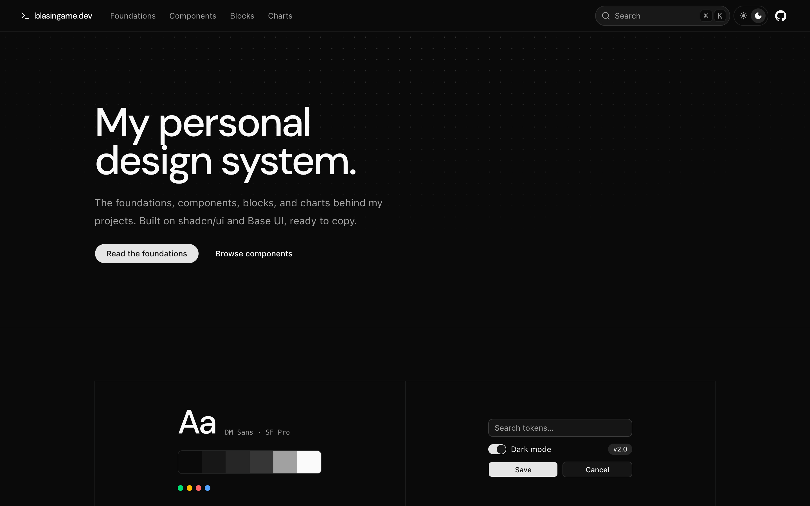
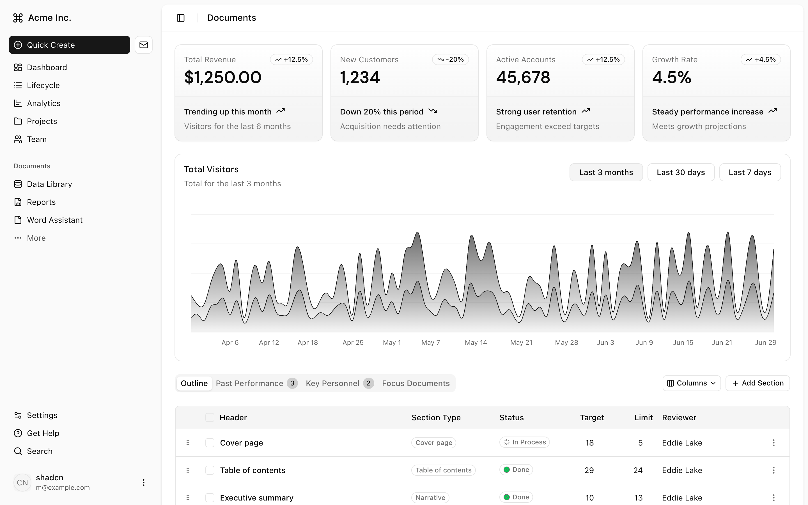
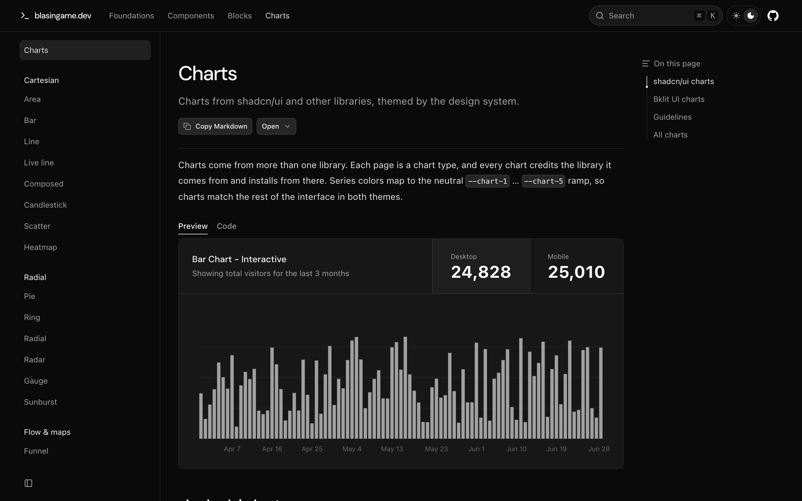

# blasingame.dev

My personal design system: foundations, components, blocks, and charts, built on [shadcn/ui](https://ui.shadcn.com) (Base UI, `base-nova` style) and documented with [Fumadocs](https://fumadocs.dev).

## Screenshots

**Home · dark theme**



**Dashboard block · light theme**



**Charts · dark theme**



## Develop

```sh
bun install
bun run dev        # http://localhost:3000
bun run build      # static export to out/
bun run types:check
bun run test       # focused interaction and hydration checks
```

## Structure

| Path | What |
| --- | --- |
| `content/docs/{foundations,components,blocks,charts}` | MDX pages. Each folder is a top-level tab. |
| `src/app/global.css` | Theme tokens. The Foundations pages read values from here. |
| `src/components/ui` | shadcn/ui components, installed with the CLI. |
| `src/components/charts` | Bklit UI chart components, installed from the `@bklit` registry. |
| `src/registry/charts` | Chart previews (shadcn gallery and Bklit examples), one default export per file. |
| `src/registry/blocks` | Full-page blocks, rendered at `/view/<name>` and embedded in an iframe. |
| `scripts/registry.mjs` | Generates the lazy preview index (`src/registry/__index__.tsx`). |

Use a preview in MDX with `<ComponentPreview name="chart-area-default" />` or `<BlockPreview name="dashboard-01" />`. Credit a library with `sources` frontmatter (libraries are listed in `src/lib/libraries.ts`); the page header links to it.

## Deploy

Temporary revert pilot: `next.config.mjs` intentionally rejects Cloudflare Pages builds on `main` so proj can prove it opens a protected revert PR after an auto-merge. CI, local and preview builds are unaffected. The last successful production deployment stays live. Remove the guard and this paragraph after verifying the revert PR; do not change the Cloudflare build settings.

The site is a static export (`output: 'export'`) hosted on Cloudflare Pages at https://components.blasingame.dev. Pages is connected to this repo and builds every push to `main`:

| Setting | Value |
| --- | --- |
| Build command | `bun run build` |
| Output directory | `out` |

`public/_headers` sets long-lived caching for `/_next/static/*`. `NEXT_PUBLIC_SITE_URL` overrides the canonical URL (defaults to `https://components.blasingame.dev`). Preview the export locally with `bun run build && bun run start`.

## Security maintenance

Keep `next` and `eslint-config-next` on the same reviewed patch and commit `bun.lock` with them. The [November 2026 security release](https://nextjs.org/blog/november-2026-security-release) fixed seven advisories in 16.4.5; the [16.4.6 release](https://github.com/vercel/next.js/releases/tag/v16.4.6) adds patch fixes in the same minor.

Production serves the static `out/` directory on Cloudflare Pages, with no Next.js server, Edge runtime or built-in image optimizer deployed. The listed server-runtime attack paths are therefore not deployed by this configuration; this is not a reason to retain affected build/development dependencies. Local `next dev` still runs a Next.js server; keep that toolchain patched too. Recheck applicability if the hosting mode changes.

Next.js's agent upgrade reminder can allow the same command to pass on retry without updating a package. Verify the resolved version and current advisory data as well as the tests, clean typecheck, lint and static build; a passing retry alone is not remediation. Keep update checks enabled.

## Frontend patterns and experiments

[Reusable patterns](content/docs/foundations/patterns.mdx) describes row, form and dialog states and interaction expectations. The isolated [UI SDK pilot](content/docs/components/ui-sdk-pilot.mdx) is experimental; Base UI remains the default. Both are included by the existing Markdown and `llms.txt` endpoints.

Run `bun run test`, `bun run types:check`, `bun run lint` and `bun run build` before publishing a change. Automated DOM checks do not prove visual layout, contrast or touch behavior; record browser evidence separately.
