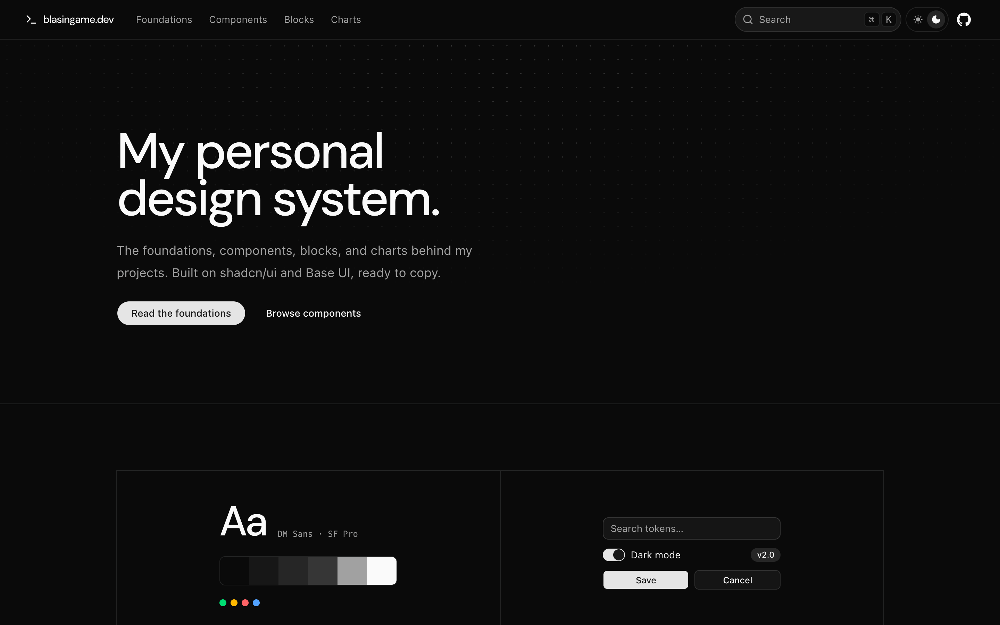
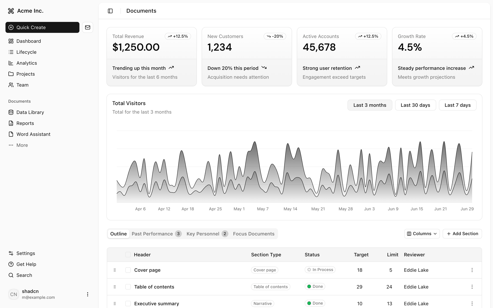
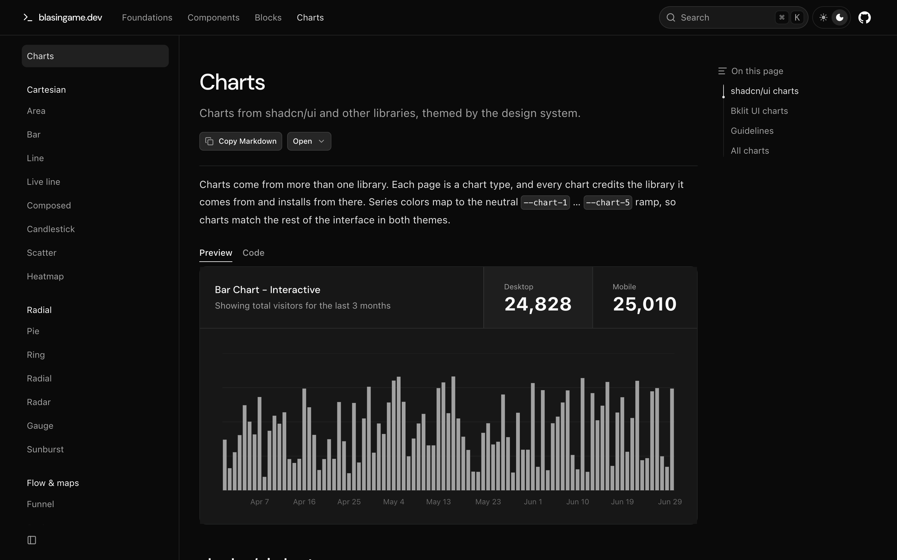

# blasingame.dev

My personal design system: foundations, components, blocks, and charts, built on [shadcn/ui](https://ui.shadcn.com) (Base UI, `base-nova` style) and documented with [Fumadocs](https://fumadocs.dev).

## Screenshots

**Home · dark theme**



**Dashboard block · light theme**



**Charts · dark theme**



## Develop

```sh
bun install
bun run dev        # http://localhost:3000
bun run build      # static export to out/
bun run types:check
```

## Structure

| Path | What |
| --- | --- |
| `content/docs/{foundations,components,blocks,charts}` | MDX pages. Each folder is a top-level tab. |
| `src/app/global.css` | Theme tokens. The Foundations pages read values from here. |
| `src/components/ui` | shadcn/ui components, installed with the CLI. |
| `src/components/charts` | Bklit UI chart components, installed from the `@bklit` registry. |
| `src/registry/charts` | Chart previews (shadcn gallery and Bklit examples), one default export per file. |
| `src/registry/blocks` | Full-page blocks, rendered at `/view/<name>` and embedded in an iframe. |
| `scripts/registry.mjs` | Generates the lazy preview index (`src/registry/__index__.tsx`). |

Use a preview in MDX with `<ComponentPreview name="chart-area-default" />` or `<BlockPreview name="dashboard-01" />`. Credit a library with `sources` frontmatter (libraries are listed in `src/lib/libraries.ts`); the page header links to it.

## Deploy

The site is a static export (`output: 'export'`) hosted on Cloudflare Pages at https://components.blasingame.dev. Pages is connected to this repo and builds every push to `main`:

| Setting | Value |
| --- | --- |
| Build command | `bun run build` |
| Output directory | `out` |

`public/_headers` sets long-lived caching for `/_next/static/*`. `NEXT_PUBLIC_SITE_URL` overrides the canonical URL (defaults to `https://components.blasingame.dev`). Preview the export locally with `bun run build && bun run start`.
